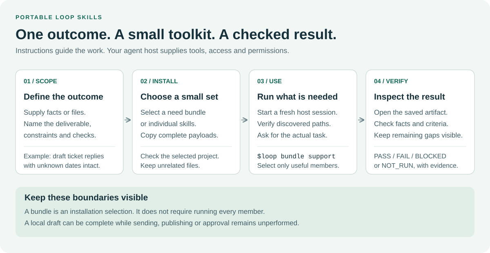

# Portable Loop Skills

**53 bounded workflows for everyday work and software development.** Give your agent a
specific outcome, work through a small batch, check the result and leave a useful
checkpoint. Choose a focused skill or a small installation bundle.

Experimental version **1.10.1-experimental** · 15 groups · 14 bundles · Python 3.11+
for repository tools. These are portable instructions and local helpers; your
agent host supplies execution tools and permissions.



[Start here](docs/guides/START-HERE.md) ·
[14 bundle workflow diagrams](docs/guides/BUNDLE-WORKFLOWS.md) ·
[What has actually been tested](docs/EVIDENCE.md) ·
[Install by need](docs/guides/INSTALL-BY-NEED.md) ·
[Browse all skills](#skill-catalog)

## Quick start

Open this repository in your agent host, then choose the outcome you need. You can
ask your agent to install the selected bundle into another project; you do not
need to code to use the everyday workflows. See [start here](docs/guides/START-HERE.md)
for the full sequence, including a first prompt and expected output.

| Your task | Start here | Small installation choice |
|---|---|---|
| Scope an unclear request or triage support | `loop-intake`, `loop-support` | `support` |
| Maintain source-linked notes or a FAQ | `loop-knowledge` | `knowledge` |
| Complete an office/personal work package | `loop-work` | `work` or `office` |
| Draft or summarize text | `loop-write`, `loop-summarize` | `writing` |
| Organize local files | `loop-files` | `files` |
| Analyze a table and create a report | `loop-table`, `loop-document` | `data` |
| Produce a document artifact | `loop-document` | `documents` |
| Study or compare everyday options | `loop-learn`, `loop-decide` | `learning`, `decisions` |
| Implement or repair software | `loop-code` or `loop-debug` | `developer` |
| Coordinate a software project | `loop-workflow-project` | `project` |

Open the [bundle workflow atlas](docs/guides/BUNDLE-WORKFLOWS.md) for one image per
bundle: when to choose it, why to iterate, the feedback/stop path, recommended
checks and mistakes to avoid. Each image has an accessible text equivalent.

```text
python scripts/install_skills.py --list
python scripts/doctor_skills.py --bundle work --bundle documents --target "/my/project/.agents/skills"
python scripts/install_skills.py --bundle work --bundle documents --target "/my/project/.agents/skills"
python scripts/install_skills.py --bundle work --bundle documents --target "/my/project/.agents/skills" --check
```

Replace the example with your selected project. Python 3.11+ is required for these
commands; an agent can use an available interpreter. A manual full-folder copy
option is in [install by need](docs/guides/INSTALL-BY-NEED.md). The installer includes
declared helpers/references/assets, preserves unrelated files and backs up managed
overwrites. An individual `--skill` selection does not require a bundle registry.
The optional doctor is read-only: it separates absent, incomplete and changed
managed payloads without claiming your host discovered or executed them.

Open the selected project in your host, start a fresh session and confirm actual
skill discovery. `.agents/skills`, `.github/skills` and `.claude/skills` are the
maintained native layouts; identical files do not prove equivalent host behavior.

## Short names and bundles

On Codex hosts supporting dollar skill mentions, use `$loop code ...`,
`$loop lc ...`, `$loop bundle office ...` or `$loop bundle support ...` after the
selected skills are installed and discovered. The requested picker display names
include **Loop Code (lc)** and **Loop Debug (dbg)**; actual picker matching has
not been verified for this release.
The gateway chooses the smallest needed workflow; bundles do not run every member.
Native slash aliases and picker search depend on the host. See the
[lookup and shortcut guide](docs/guides/SKILL-FINDER.md) for verified CLI forms,
installation and limitations. No duplicate alias skills are installed.

## Choose a focused workflow

```text
Use $loop-work to create the requested event brief and feasible task checkpoint
from these notes. Preserve unknown dates and approvals. Create the local files,
reopen them and report checks. Do not book, send or schedule anything.
```

For code, use research-repo when orientation is needed, code or debug for the
requested change, relevant tests and review. For files/data/documents, verify
actual paths, contents, units and outputs. Do not invoke every installed skill.
`loop-organize` remains a selector for older/mixed requests; explicit file work
now uses files, and personal/office deliverables use work.

[Everyday examples](docs/guides/EVERYDAY-WORK.md) ·
[Work and artifact guide](docs/guides/WORK-AND-ARTIFACTS.md) ·
[Role toolkits and English visuals](docs/guides/ROLE-WORKFLOWS.md) ·
[Practical prompts](docs/guides/WORKFLOW-EXAMPLES.md)

## Evidence for 1.10

Published commit: [`c6255a1`](https://github.com/Clas4444/loop-skills-repository/commit/c6255a192c56c633c21889886c6080230bb774aa).
Results below belong to that release and the recorded fixtures, not every future
checkout or every possible task.

| Checked layer | Observed result | Inspect the evidence |
|---|---|---|
| Release CI | 4/4 jobs successful, Ubuntu/Windows × Python 3.11/3.12 | [GitHub Actions run](https://github.com/Clas4444/loop-skills-repository/actions/runs/40320619298) |
| Final local export, Python 3.12 and 3.14 | Each: 14/14 gates; 318 tests discovered, 317 passed, 1 Windows symlink skip | [1.10 report and pinned sessions](docs/testing/RESULTS-1.10.md#final-verified-export) |
| Installation | 14 bundle journeys; all 53 skills / 117 payloads per layout, 351 backup byte comparisons | [Installation records](docs/EVIDENCE.md#installation-evidence) |
| Explicit-load Codex trials | Support PASS; knowledge PASS; original work FAIL retained; schema-explicit work retry PASS | [Inputs, outputs and limits](docs/EVIDENCE.md#behavioral-evidence) |
| Native discovery and broad reliability | NOT_RUN | [Untested scope](docs/EVIDENCE.md#what-remains-unverified) |

The [evidence map](docs/EVIDENCE.md) includes readable source-to-output examples,
raw artifact locations and the failed trial. CLI lookup and matching installation
bytes do not establish native picker behavior or execution of all 53 skills.

## Run repository checks

Use a fresh [session-pinned campaign](docs/testing/TESTING.md) for consolidated
results. PASS means the named check ran and met its criterion; FAIL is an observed
violation, BLOCKED a missing prerequisite and NOT_RUN an unexecuted check.

<details>
<summary>Repository commands (no model calls)</summary>

```text
python -m unittest discover -s tests -v
python scripts/validate.py
python -m scripts.validate --profile format
python scripts/catalog.py
python scripts/routing_check.py
python scripts/discovery.py
python scripts/workflows.py
python scripts/docs_check.py
python scripts/install_skills.py --list
python scripts/doctor_skills.py --all --target .github/skills
python scripts/skill_resources.py
python scripts/evidence_indexes.py
python scripts/sync_skills.py --target .github/skills --check
python scripts/runtime_smoke.py --help
python -m compileall -q scripts tests
git diff --check
```

</details>

Unit tests, real CLI/artifact checks, model decisions, native discovery and external
actions are separate layers. Missing tools and zero collected tests are not PASS.

Earlier sessions: [three-hour work log](docs/testing/AUTONOMOUS-3H-2026-10-25.md) ·
[audit and paired pilot](docs/testing/AUDIT-AB-2026-10-25.md) ·
[1.9 tests](docs/testing/RESULTS-1.9.md) ·
[historical runtime matrix](docs/RUNTIME-TEST-MATRIX.md).

## Skill catalog

<!-- BEGIN GENERATED SKILL GROUPS -->

Groups are navigation metadata; native skill directories remain flat.

### Skill selection and bundle lookup

| Skill | Purpose |
|---|---|
| [loop](.github/skills/loop/SKILL.md) | Find Loop skills by spaced names, shortcuts such as lc/dbg/kb, or need-based bundles |

### Discovery and scoped planning

| Skill | Purpose |
|---|---|
| [loop-research](.github/skills/loop-research/SKILL.md) | Research a scoped everyday or technical question using primary sources, explicit criteria and a dated source ledger |
| [loop-research-repo](.github/skills/loop-research-repo/SKILL.md) | Research repositories and open-source projects in a bounded evidence loop |
| [loop-research-tools](.github/skills/loop-research-tools/SKILL.md) | Research tools, extensions, plugins, skills, and MCP servers in a bounded evidence loop |
| [loop-plan](.github/skills/loop-plan/SKILL.md) | Turn a scoped request into dependency-ordered, verifiable implementation batches without changing code |
| [loop-context](.github/skills/loop-context/SKILL.md) | Prepare a compact, source-linked context packet for a specific task from existing artifacts |
| [loop-knowledge](.github/skills/loop-knowledge/SKILL.md) | Build or update a small source-linked knowledge set from multiple supplied documents, preserving conflicts, unknowns and revision identity |

### Implementation and maintenance

| Skill | Purpose |
|---|---|
| [loop-code](.github/skills/loop-code/SKILL.md) | Implement an authorized feature or configuration change in small verified batches |
| [loop-refactor](.github/skills/loop-refactor/SKILL.md) | Improve a scoped code structure while preserving observable behavior through characterization tests, small reversible changes and regression checks |
| [loop-dependencies](.github/skills/loop-dependencies/SKILL.md) | Assess and perform an authorized dependency change with manifest/lockfile consistency, compatibility checks and rollback evidence |
| [loop-migrate](.github/skills/loop-migrate/SKILL.md) | Prepare and verify a scoped data, schema or configuration migration with dry-run, backup, invariants, idempotence and rollback |

### Debugging and diagnosis

| Skill | Purpose |
|---|---|
| [loop-debug](.github/skills/loop-debug/SKILL.md) | Repair a reproducible bug end to end: capture a failing test, isolate the cause, apply the smallest authorized fix, and rerun regression checks |
| [loop-diagnose](.github/skills/loop-diagnose/SKILL.md) | Investigate an unexplained symptom using competing hypotheses and discriminating experiments |
| [loop-diagnose-repro](.github/skills/loop-diagnose-repro/SKILL.md) | Run a bounded reproduction loop for a bug or failure: capture the environment, minimize the reproducer, vary one factor at a time, and preserve exact evidence for a later fix |
| [loop-diagnose-performance](.github/skills/loop-diagnose-performance/SKILL.md) | Run a bounded performance-diagnosis loop for slow, memory-heavy, or resource-intensive behavior |
| [loop-diagnose-regression](.github/skills/loop-diagnose-regression/SKILL.md) | Run a bounded regression-diagnosis loop: compare a known-good and failing state, bisect or narrow the change set, reproduce the regression, and verify the smallest authorized fix |

### Testing and evidence evaluation

| Skill | Purpose |
|---|---|
| [loop-test](.github/skills/loop-test/SKILL.md) | Select and execute a risk-based test strategy for a project or change when the required test layer is not yet known |
| [loop-test-unit](.github/skills/loop-test-unit/SKILL.md) | Run a bounded unit-test loop for a module or function: select focused tests, reproduce failures, improve authorized tests or fixtures, and verify isolated behavior without weakening acceptance criteria |
| [loop-test-integration](.github/skills/loop-test-integration/SKILL.md) | Run a bounded integration-test loop across services, processes, files, databases, or external boundaries |
| [loop-test-coverage](.github/skills/loop-test-coverage/SKILL.md) | Run a bounded test-coverage loop: identify untested risk, inspect coverage evidence, add authorized focused tests, and verify that coverage improvements are meaningful rather than cosmetic |
| [loop-test-e2e](.github/skills/loop-test-e2e/SKILL.md) | Verify a complete user-visible journey through its real entry point, including success, invalid input and observable side effects |
| [loop-test-adversarial](.github/skills/loop-test-adversarial/SKILL.md) | Challenge a declared contract with isolated adversarial inputs and independently observed outcomes |
| [loop-test-compatibility](.github/skills/loop-test-compatibility/SKILL.md) | Verify a declared compatibility matrix across versions, platforms, host adapters or data formats |
| [loop-evaluate](.github/skills/loop-evaluate/SKILL.md) | Evaluate a skill or agent workflow using predefined cases, an explicit rubric and independently checked outcomes |

### Review and security assurance

| Skill | Purpose |
|---|---|
| [loop-review](.github/skills/loop-review/SKILL.md) | Inspect a scoped change or repository and report prioritized findings with source evidence |
| [loop-security](.github/skills/loop-security/SKILL.md) | Review authorized code and configuration for security risks using threat boundaries, source evidence and safe local tests |

### Delivery and operational verification

| Skill | Purpose |
|---|---|
| [loop-docs](.github/skills/loop-docs/SKILL.md) | Run a bounded documentation loop: audit README, guides, API references, examples, localization, and generated documentation; propose or make authorized updates; verify links and consistency |
| [loop-ci](.github/skills/loop-ci/SKILL.md) | Diagnose and repair scoped CI failures by tracing a failed job to logs, reproducing locally where possible, and verifying workflow changes |
| [loop-release](.github/skills/loop-release/SKILL.md) | Prepare and verify a scoped release candidate: version consistency, reproducible build, package contents, changelog and rollback notes |
| [loop-deploy](.github/skills/loop-deploy/SKILL.md) | Execute or rehearse a scoped deployment of a known release with health gates and rollback evidence |
| [loop-observe](.github/skills/loop-observe/SKILL.md) | Assess whether logs, metrics, traces and health signals can detect and explain an operational failure |

### Skill authoring and agent continuation

| Skill | Purpose |
|---|---|
| [loop-skill-create](.github/skills/loop-skill-create/SKILL.md) | Create or maintain an agent skill through requirements, reusable-pattern inspection, synchronized editing, focused tests, documentation, and evidence review |
| [loop-orchestrate](.github/skills/loop-orchestrate/SKILL.md) | Run bounded follow-up prompts through a configured headless coding-agent command with state, timeout, stop markers, and evidence |
| [loop-prompt](.github/skills/loop-prompt/SKILL.md) | Run an initial user prompt, have the agent infer the next useful prompt, and execute a bounded number of follow-up prompts with evidence |
| [loop-handoff](.github/skills/loop-handoff/SKILL.md) | Create or validate a resumable checkpoint for unfinished agent work across sessions |

### MCP integration and tool trust

| Skill | Purpose |
|---|---|
| [loop-mcp-design](.github/skills/loop-mcp-design/SKILL.md) | Design a scoped MCP client/server integration around a pinned protocol version, tool contracts and trust boundaries |
| [loop-mcp-test](.github/skills/loop-mcp-test/SKILL.md) | Exercise a versioned MCP interface using bounded local fixtures or an explicitly authorized server |
| [loop-mcp-security](.github/skills/loop-mcp-security/SKILL.md) | Review an authorized MCP integration for tool trust, scoped authorization, credential handling and data-exfiltration boundaries |

### End-to-end project workflows

| Skill | Purpose |
|---|---|
| [loop-workflow-project](.github/skills/loop-workflow-project/SKILL.md) | Turn an authorized small software project idea into an incremental delivery workflow with an MVP boundary, acceptance backlog, first verified slice and resumable state |
| [loop-workflow-pr](.github/skills/loop-workflow-pr/SKILL.md) | Prepare a reviewable pull-request delivery packet from a scoped branch or diff: establish the base, review changes, verify checks and write a truthful description |
| [loop-workflow-incident](.github/skills/loop-workflow-incident/SKILL.md) | Coordinate an active service-incident assessment: establish impact, separate observations from hypotheses, choose authorized containment and verify recovery |

### Everyday writing and source summaries

| Skill | Purpose |
|---|---|
| [loop-write](.github/skills/loop-write/SKILL.md) | Draft or revise factual everyday emails, letters and short communications for a stated reader, preserving source facts, intent and unresolved commitments |
| [loop-summarize](.github/skills/loop-summarize/SKILL.md) | Condense supplied documents, notes or transcripts into a traceable summary while preserving material qualifiers, numbers, contradictions and source coverage |

### Work delivery, meetings and file organization

| Skill | Purpose |
|---|---|
| [loop-work](.github/skills/loop-work/SKILL.md) | Complete a bounded everyday work package: turn a messy request into feasible priorities, produce the authorized deliverables, and leave a source-backed checkpoint |
| [loop-meeting](.github/skills/loop-meeting/SKILL.md) | Prepare an agenda or turn supplied meeting material into source-linked decisions, proposals, actions and unresolved questions |
| [loop-organize](.github/skills/loop-organize/SKILL.md) | Choose the right organization workflow for existing files or personal work items |
| [loop-files](.github/skills/loop-files/SKILL.md) | Organize selected local files through a pinned inventory, collision-safe mapping, authorized native moves and verified recovery |

### Everyday decisions and learning

| Skill | Purpose |
|---|---|
| [loop-decide](.github/skills/loop-decide/SKILL.md) | Compare everyday options against explicit constraints, evidence, priorities and uncertainty, then give a conditional choice or decision record |
| [loop-learn](.github/skills/loop-learn/SKILL.md) | Create a feasible learning plan or conduct a practice session using observable goals, retrieval, feedback and spaced review |

### Tables and document artifacts

| Skill | Purpose |
|---|---|
| [loop-table](.github/skills/loop-table/SKILL.md) | Inspect, clean or analyze supplied tables with explicit types, units, missing-value rules and source-preserving output checks |
| [loop-document](.github/skills/loop-document/SKILL.md) | Create or revise a usable document artifact with source-faithful content, requested file format and separate content/layout/export checks |

### Request intake and support triage

| Skill | Purpose |
|---|---|
| [loop-intake](.github/skills/loop-intake/SKILL.md) | Turn an ambiguous office or personal request into a source-backed brief with acceptance criteria, blockers and a bounded next action |
| [loop-support](.github/skills/loop-support/SKILL.md) | Triage supplied support tickets into evidence-backed categories, impact, uncertainty and response drafts |

<!-- END GENERATED SKILL GROUPS -->

## Optional headless loops

The standalone continuation runner remains available through loop-orchestrate and
loop-prompt. It does not install/authenticate an agent or grant permissions.
See [protocol and finite limits](docs/ORCHESTRATION.md) before an authorized run.
Model calls are not part of CI. New helpers are self-contained read-only checkers;
they do not provide an office suite, messaging service or file transaction manager.

## Documentation

[Documentation map](docs/README.md) · [Architecture](docs/ARCHITECTURE.md) ·
[Authoring](docs/AUTHORING.md) · [Data contracts](schemas/README.md) ·
[Contributing](CONTRIBUTING.md) · [Changelog](CHANGELOG.md) · [Security](SECURITY.md)

## License and ownership

An independent project maintained at
[Clas4444/loop-skills-repository](https://github.com/Clas4444/loop-skills-repository),
distributed under the [MIT license](LICENSE). This repository is not a fork of
its research references and is not affiliated with OpenAI, Anthropic, GitHub or
Microsoft. No external benchmark result is a performance claim for this project.
