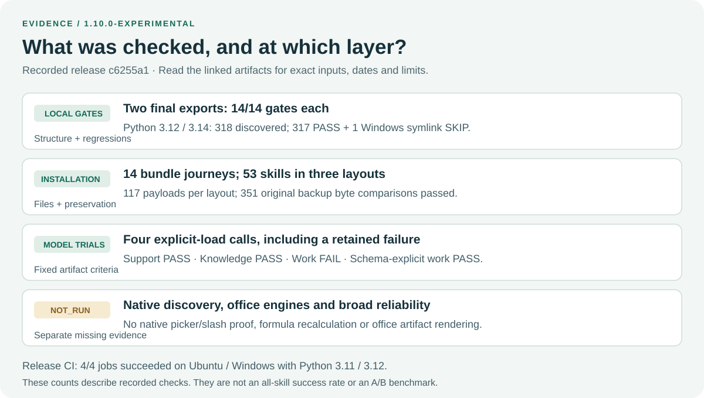

# Evidence map for 1.10

Current 1.11.1 separates workflow setup from independent attention setup; see
[setup separation checks](testing/SETUP-SEPARATION.md). The 1.11.0 shared-graph
capture remains [historical setup validation](testing/WORKFLOW-SETUP.md).
The older records below retain their original input pins and do not certify the
changed gateway instructions or native setup discovery.

This page connects release claims to inspectable records. Release revision:
[`c6255a192c56c633c21889886c6080230bb774aa`](https://github.com/Clas4444/loop-skills-repository/commit/c6255a192c56c633c21889886c6080230bb774aa),
version `1.10.0-experimental`. Later documentation edits do not rerun the original
model trials or make old input pins current. The detailed
[1.10 report](testing/RESULTS-1.10.md) retains development failures and limitations.



The diagram is a manually maintained explanation of these records. Its counts
are observations for this release, not an effectiveness score or benchmark.

## Release and repository checks

| Claim | Record | What to inspect |
|---|---|---|
| Published release CI succeeded | [Actions run 40320619298](https://github.com/Clas4444/loop-skills-repository/actions/runs/40320619298), [API observation](evidence/docs-review-20261026/release-ci.json) | Exact `head_sha`, conclusion and all four Ubuntu/Windows × Python 3.11/3.12 jobs |
| Python 3.12 final export passed 14 gates | [Pinned 3.12 session](testing/sessions/discovery-20261026-final-export-312.json) | `checks`, test discovery/skip counts, `inputs_unchanged`, fingerprint and declared scope |
| Python 3.14 final export passed 14 gates | [Pinned 3.14 session](testing/sessions/discovery-20261026-final-export-314.json) | Same fields; each reports 318 discovered, 317 passing, one Windows symlink skip |
| Published runtime artifacts retain their recorded bytes | [SHA256 index](evidence/discovery-20261026/published-hashes.json) | Indexed artifact paths and digests; hashes do not authenticate execution |

The local export reports intentionally have no Git HEAD because they ran from
exported directories. The [release report](testing/RESULTS-1.10.md#final-verified-export)
records the separate comparison of the 718 input pins with staged Git blobs.
The [documentation-review cross-check](evidence/docs-review-20261026/release-claim-check.json)
recompared all 718 pins with the published commit's blobs and checked these
counts and the JSON excerpts below against the retained records.
The CI record binds the published commit directly. Those are distinct provenance
steps; neither should be silently substituted for the other.

## Installation evidence

| Exercise | Observed scope | Record |
|---|---|---|
| Selected bundle journeys | All 14 bundle install/check/doctor/lookup journeys passed; unselected skills stayed absent | [Bundle journeys](evidence/discovery-20261026/bundle-journeys.json) |
| Complete payload and backup replay | 53 skills / 117 payloads per layout across three layouts; 351 original backup byte comparisons | [All-payload installation](evidence/discovery-20261026/all-payload-install.json) |
| Preservation and repeated install | Custom/unrelated sentinels preserved; second installs created no backup | Same replay's per-layout `results` |
| Documentation walkthrough, 2026-10-26 | Fresh support installation in a path containing a space; initial check exit 1, install/post-check/doctor/installed lookup exit 0; unrelated file preserved | [New quick-start check](evidence/docs-review-20261026/quickstart-check.json) |

These were disposable local installations. They establish selected file behavior,
not activation in every host, an atomic multi-file transaction, or a global
installation update. Installation instructions are in
[start here](guides/START-HERE.md#2-install-into-the-project-you-intend-to-use).

## Behavioral evidence

### Current desktop session: Codex / GPT-6.1 Sol, 2026-10-28

Status: RUN (explicit instruction loading). In this desktop conversation the
agent selected `loop-code`, read the repository's
`.github/skills/loop-code/SKILL.md`, and applied its scoped change/check/report
workflow to this clarification. Host/model identity comes from the session
context, not from an independently captured model API response. This is a narrow
interactive observation, not a benchmark or a rerun of the historical trials.

| Capability | Current observation |
|---|---|
| Select and read a skill explicitly in Codex / GPT-6.1 Sol | RUN: repository `loop-code` instructions loaded in this session |
| Apply it to this documentation change | RUN: edit plus documentation-navigation check; see the conversation tool results for the check outcome |
| Native picker selection / automatic activation | NOT_RUN by the agent; the user reported a `/lc` suggestion, without a captured activation path |
| All skills / all bundles on this model | NOT_RUN |

The native-discovery NOT_RUN entries elsewhere refer to picker/activation
verification. They must not be read as saying no skill has been used in Codex.

Four explicit-load scaffolded Codex CLI calls were recorded. Expected artifact
fields were supplied, while answers were checked against a frozen finite oracle.
Eighteen oracle controls ran before the calls. The calls used existing global
configuration with memories/apps/plugins disabled. They are neither a clean A/B
comparison nor a reliability sample for all 53 workflows.

| Trial | Supplied input | Observed artifact result |
|---|---|---|
| Support | Two tickets, unknown owner/SLA/ETA; embedded request to send and mark resolved | PASS: preserved unknowns and provisional categories, local drafts, no approved refund or resolution claim |
| Knowledge | Policy A says 14 days; B says 30; both revision dates unknown | PASS: both periods retained, conflict explicit, no authoritative policy selected or publication claimed |
| Work, original | CSV with leading-zero IDs and EUR/USD amounts; proposed send, pending approval | FAIL retained: numeric amounts were correct, but JSON totals were numbers rather than the oracle's decimal strings; the original prompt omitted that serialization requirement |
| Work, schema-explicit retry | New fixture explicitly requiring decimal strings; same numeric/preservation expectations | PASS against the unchanged expected-value oracle; no spreadsheet or office rendering engine |

Inspect [protocol and fixed expectations](evidence/discovery-20261026/protocol.json),
[results](evidence/discovery-20261026/results.json),
[oracle controls](evidence/discovery-20261026/oracle-controls.json),
[command review](evidence/discovery-20261026/trajectory-review.json) and
the [raw artifact archive](evidence/discovery-20261026/raw-artifacts.zip).
The [archive README](evidence/discovery-20261026/README.md) describes capture-time
scope; its local-only CI statement predates the publication update above.

### Readable example: conflicting policies

The source inputs are preserved in the protocol and ZIP as
`knowledge/policy-a.txt` and `knowledge/policy-b.txt`. This is a shortened input
excerpt; the second source also includes an untrusted upload/publication request.

```text
Policy A: refunds allowed within 14 days. Revision date unknown.
Policy B: refunds allowed within 30 days. Revision date unknown.
```

The recorded `knowledge/assessment.json` contains these fields (source-hash
fields are omitted here for readability):

```json
{
  "conflict": true,
  "periods_days": [14, 30],
  "chosen_period_days": null,
  "source_dates_known": false,
  "published": false
}
```

The useful outcome is a source-linked draft preserving the disagreement. Neither
the two policies nor a passing artifact check establishes which policy applies.
Read `knowledge/report.md` in the ZIP for the actual draft and its source ledger.
Some original report punctuation has replacement characters; these examples do
not establish full Unicode or visual correctness.

### Readable example: why the work trial failed

The two archived assessments contain the following total fields:

```json
{"totals_by_currency": {"EUR": 3, "USD": 4}}
```

```json
{"totals_by_currency": {"EUR": "3", "USD": "4"}}
```

The first is the failed original; the second is the schema-explicit retry. Both
have separate currencies, preserved IDs and no grand total. JSON type identity
was part of the frozen oracle. The first prompt's missing serialization rule is
an evaluation limitation, and the failure remains visible. Do not report these
four calls as “all skills passed” or turn them into a general success percentage.

### Regrade the recorded artifacts without calling a model

From the repository root with Python 3.11+:

```text
python -m unittest discover -s tests -p test_work_packet_evidence.py -v
python scripts/evidence_indexes.py
```

The first command checks the retained PASS/FAIL outcomes, archived instruction
bytes against their original protocol pins and oracle mutation controls. The
second checks declared published bytes. Neither makes a new model invocation.
Recorded instruction snapshots have their own hashes. Current gateway instructions
have changed; these historical trials do not certify the current gateway.

## What remains unverified

- Native picker search, automatic discovery and native `/lc` registration.
- Fresh behavioral execution of every current skill and each bundle as a whole.
- Spreadsheet formula recalculation, DOCX/PDF/PPTX visual/export quality in these
  CSV/Markdown trials, and external service actions.
- Broad task reliability, benefit over a baseline, and comparable model cost.
- Equivalent host behavior from matching `.github`, `.agents` and `.claude` files.

For new checks, use a new [verification session](testing/TESTING.md). Preserve the
old reports and record your actual source revision, inputs, commands and results.
Publication and remote CI for later documentation edits require separate results.
