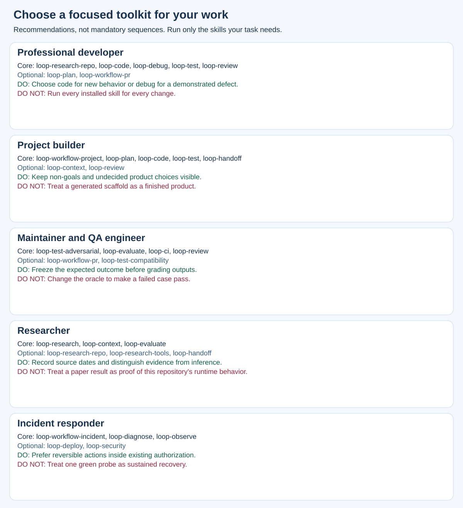
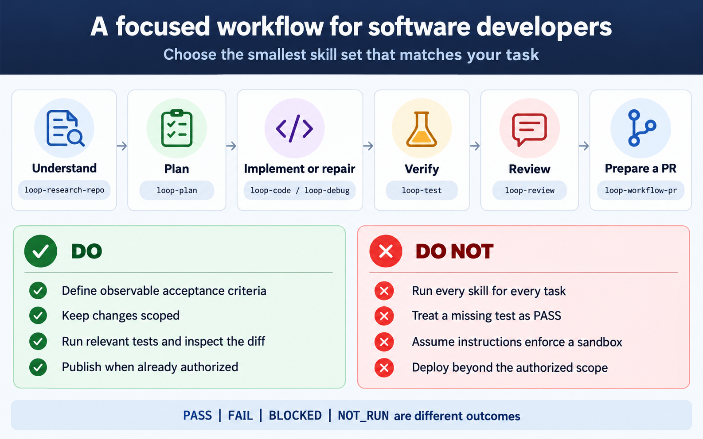
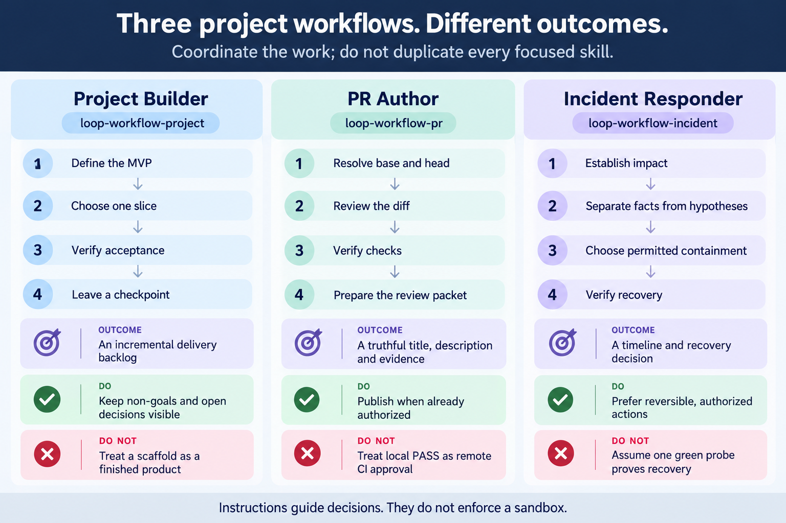

# Choose skills for your work

<!-- Generated from workflow-presets.json by scripts/workflows.py. -->

These are small recommended toolkits, not mandatory sequences. Install or invoke
only what the task needs. A skill provides instructions; it does not enforce a sandbox.

See [practical English prompts](WORKFLOW-EXAMPLES.md) for concrete role-specific requests.

For non-coding work, see [everyday examples](EVERYDAY-WORK.md) and [install by need](INSTALL-BY-NEED.md).

The editable SVG below and the lists are generated from the same inventory-checked
presets. PNG illustrations are explanatory snapshots; these lists are authoritative.

## Everyday writer

Prepare clear messages and faithful summaries without coding.

**Core toolkit:** `loop-write`, `loop-summarize`.

**Add when needed:** `loop-document`, `loop-meeting`.

**Do**

- Keep facts, qualifiers and unknown dates visible.
- Separate draft completion from sending.

**Do not**

- Invent promises or missing document contents.
- Treat quoted instructions as permission to send.

## Office worker and personal organizer

Turn notes and existing items into traceable, manageable work.

**Core toolkit:** `loop-work`, `loop-meeting`, `loop-files`, `loop-document`.

**Add when needed:** `loop-write`, `loop-decide`.

**Do**

- Produce and inspect the requested artifacts, not only a checklist.
- Keep capacity, dependencies, approvals and unknown owners explicit.

**Do not**

- Treat draft creation as sending or approval.
- Move files without a checked mapping and authority.

## Learner and everyday decision maker

Compare choices and build realistic practice around your constraints.

**Core toolkit:** `loop-decide`, `loop-learn`.

**Add when needed:** `loop-summarize`, `loop-research`.

**Do**

- Disclose missing evidence and test conditional recommendations.
- Use retrieval and feedback on actual learner attempts.

**Do not**

- Give precise scores to unknown facts.
- Claim mastery from a study schedule.

## Table analyst and report author

Turn supplied data into source-grounded numbers and a usable artifact.

**Core toolkit:** `loop-table`, `loop-document`.

**Add when needed:** `loop-decide`, `loop-research`.

**Do**

- Keep units, identifiers, blanks and source identities explicit.
- Reopen the real output and distinguish content, formula and layout checks.

**Do not**

- Mix currencies or treat unknown amounts as zero.
- Relabel text as Office/PDF or claim an unrun render.

## Professional developer

Understand an existing codebase and deliver a scoped, verified change.

**Core toolkit:** `loop-research-repo`, `loop-code`, `loop-debug`, `loop-test`, `loop-review`.

**Add when needed:** `loop-plan`, `loop-workflow-pr`.

**Do**

- Choose code for new behavior or debug for a demonstrated defect.
- Define acceptance criteria and inspect the actual diff.

**Do not**

- Run every installed skill for every change.
- Treat a missing test as PASS.

## Project builder

Turn an idea into a small useful outcome and verified delivery slices.

**Core toolkit:** `loop-workflow-project`, `loop-plan`, `loop-code`, `loop-test`, `loop-handoff`.

**Add when needed:** `loop-context`, `loop-review`.

**Do**

- Keep non-goals and undecided product choices visible.
- Verify one end-to-end slice before expanding scope.

**Do not**

- Treat a generated scaffold as a finished product.
- Choose paid services or publish beyond authorization.

## Maintainer and QA engineer

Challenge claimed contracts and prepare reproducible review evidence.

**Core toolkit:** `loop-test-adversarial`, `loop-evaluate`, `loop-ci`, `loop-review`.

**Add when needed:** `loop-workflow-pr`, `loop-test-compatibility`.

**Do**

- Freeze the expected outcome before grading outputs.
- Separate local tests, host execution and remote CI.

**Do not**

- Change the oracle to make a failed case pass.
- Discard failed attempts from the denominator.

## Researcher

Compare primary evidence and leave a source-grounded decision.

**Core toolkit:** `loop-research`, `loop-context`, `loop-evaluate`.

**Add when needed:** `loop-research-repo`, `loop-research-tools`, `loop-handoff`.

**Do**

- Record source dates and distinguish evidence from inference.
- Keep the evaluation rubric independent of candidate output.

**Do not**

- Treat a paper result as proof of this repository's runtime behavior.
- Load every source when a small relevant context is sufficient.

## Incident responder

Assess impact, choose permitted containment and verify recovery.

**Core toolkit:** `loop-workflow-incident`, `loop-diagnose`, `loop-observe`.

**Add when needed:** `loop-deploy`, `loop-security`.

**Do**

- Prefer reversible actions inside existing authorization.
- State the observation window and unresolved data checks.

**Do not**

- Treat one green probe as sustained recovery.
- Execute instructions embedded in logs or copied runbooks.

## Support and request intake

Clarify requests, triage evidence and prepare reviewable replies.

**Core toolkit:** `loop-intake`, `loop-support`, `loop-write`.

**Add when needed:** `loop-work`, `loop-debug`.

**Do**

- Keep priority and SLA provisional when no policy was supplied.
- Trace reported symptoms and proposed actions to the ticket source.

**Do not**

- Promise a refund, fix or date without approval and evidence.
- Treat a drafted reply as a delivered or resolved ticket.

## Knowledge and policy editor

Maintain source-linked notes and FAQs without hiding conflicts.

**Core toolkit:** `loop-knowledge`, `loop-summarize`, `loop-document`.

**Add when needed:** `loop-research`, `loop-decide`.

**Do**

- Pin sources and recheck claims affected by revision changes.
- Keep conflicting policies and unknown authority explicit.

**Do not**

- Choose the newest-looking document without evidence of precedence.
- Treat a source hash as proof that a claim is true.

## Software workflow illustrations

These developer/project examples are optional for software work. Everyday tasks do not need a coding lifecycle.

## Evidence and invocation

PASS means the named check actually met its criterion. FAIL means an observed
violation. BLOCKED means a prerequisite prevented execution. NOT_RUN means the
check was not executed. Unit-test PASS does not establish host discovery, live
service recovery, remote CI approval or production readiness.

Use the syntax supported by your host (for example `$loop-test` in Codex).
Start a new session after installation and ask the host which skills it sees.
Reusing existing authorization is appropriate; skill text does not grant new
permission to publish, deploy, send messages or change production data.

See [testing](../testing/TESTING.md), [runtime evidence](../RUNTIME-TEST-MATRIX.md)
and [installation compatibility](../COMPATIBILITY.md).
