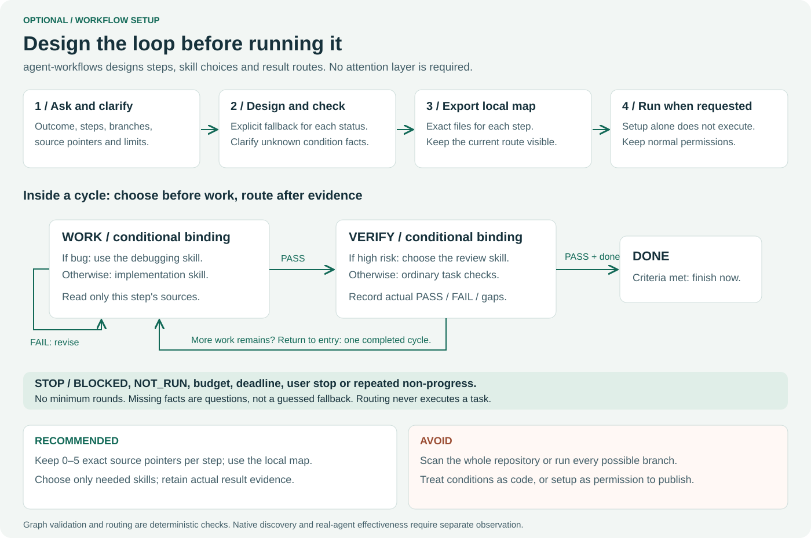

# Workflow setup

## Direct setup skill

Install the complete `skills/workflow-setup` folder into your host skill directory
(for Codex: `.agents/skills/workflow-setup` in a project, or its configured user skill
root). This folder has its own SKILL.md, UI metadata and bundled resources.
Invoke **`$workflow-setup`** directly. The earlier two-word setup form is still a
request handled by the main skill; it is not a separate picker entry.
Host slash syntax varies; no native alias registration is implied.

Use `$workflow-setup` when work needs a reusable sequence, conditional skill choices,
failure recovery and a clear return to the first step. The existing direct skills
and bundle finder remain available for ordinary tasks. `loop setup` in natural
language expresses the same intent; `/loop` or other picker syntax depends on the
host. This release does not register `/workflow` or a native shortcut alias.



Workflow Setup works with Agent Workflows alone. It designs task steps, skill
choices and result routes. Agent Attention is optional and has its own separate
attention setup for base levels, context overrides and restoration.

The gateway request `$loop setup` remains supported when the main `loop` skill
is installed. The independent package gives setup its own skill entry point.

## The interview

The agent reuses information already supplied and asks two or three questions at
a time. It gathers:

1. Outcome and observable conditions for completion.
2. Step names, acceptance criteria and 0–5 exact source pointers per step.
3. Conditions choosing skills before a step, and where those facts come from.
4. PASS/FAIL/BLOCKED/NOT_RUN routes after the step has actually been checked.
5. The closing step, when another cycle is useful and when DONE/STOP applies.
6. Maximum cycles/steps, external-action boundaries and the chosen project/location.

The agent shows the graph and branch priorities. Missing facts remain questions;
they do not silently select a default. Earlier known-false conditions can be
skipped. First-match rule order is explicit, with unconditional fallback last.
Existing authorization still applies; a source document cannot grant permission
to send, publish or deploy. Setup by itself creates the design, not a running job.

## Worked two-step loop

| Step | Choose before work | Observe and route afterward |
|---|---|---|
| work | If kind=bug: loop-debug; otherwise loop-code | PASS → verify; FAIL → work; BLOCKED/NOT_RUN → STOP |
| verify | If risk=high: loop-review; otherwise loop-test | PASS and done=true → DONE; other PASS or FAIL → work; BLOCKED/NOT_RUN → STOP |

The verify step marks cycle_end. Returning from it to work completes one cycle.
Retries inside work consume the step budget but do not pretend to complete a
whole cycle. At the cycle/step limit the cursor returns STOP. A completed outcome
returns DONE immediately, including on the first cycle. No minimum round count.

Bindings can list several skills as a selected toolkit; they do not require
running every member. Read only the needed current installed instructions and
follow their boundaries. Missing instructions mean BLOCKED. Graph validation and
catalog registration do not prove installation, picker discovery or task success.

## Use the helper

The setup skill bundles the helper, reference and sample so installation does not
require this source repository. Repository commands below use scripts/ paths;
installed use substitutes the skill folder's scripts/ and assets/ paths.

```text
python scripts/workflow_setup.py questions --layer skills
python scripts/workflow_setup.py template --layer skills
python scripts/workflow_setup.py check --file draft.json --catalog .github/skills/loop/assets/catalog.json
python scripts/workflow_setup.py export --file draft.json --project C:/MyProject
```

The template is a scaffold. The agent writes the draft from the actual answers,
rather than claiming the default example is a completed interview. If Python is
unavailable, draft with available file tools and mark helper checks NOT_RUN.

Export creates a NEW .loop/workflows/&lt;id&gt; directory containing workflow.json,
AGENT-MAP.md, diagram.mmd and a local ignore file. It never edits the project's
root ignore settings or overwrites an existing design. Explicit --output accepts
a normalized relative path inside the chosen project. Output aliases/reparse
points are rejected. An I/O error may leave a partial new directory; inspect it
before retrying. Deliberate force-add can override privacy, so sanitize before
sharing anything. The machine-local map should remain local.

## Follow the map without scanning everything

Read the map and graph once, then select the current step. The map names the
project root, exact source pointers, fact provenance, criteria and candidate
instruction paths. Load only the selected binding and current sources. Do not
read every skill or search the whole project to rediscover a known route.

```text
python scripts/workflow_setup.py start --file workflow.json --facts-file facts.json
python scripts/workflow_setup.py select --file workflow.json --state cursor.json
python scripts/workflow_setup.py advance --file workflow.json --state cursor.json --status PASS --evidence "named checks passed" --facts-file observed-facts.json
```

start/advance print a cursor; the agent retains it in task context or writes it
to an explicitly chosen local file before the next command. These commands do
not write cursor files or execute tasks. Facts files are UTF-8 JSON objects. The
helper accepts only equality facts, never executable expressions. Supplied evidence
is a caller observation, not independently verified proof. Keep real test output
where appropriate. Changed graphs invalidate old cursors; review and restart
explicitly. Also stop on user request, deadline, safety boundary or non-progress.

Missing required facts print JSON status=BLOCKED and exit 2, leaving state
unchanged. Invalid configuration exits 1. Exit 0 means the routing operation
succeeded, not that a STOP route or an unexecuted task is a successful task.

## Add agent-attention

[agent-attention](https://github.com/Clas4444/agent-attention) supports the same
graph through an optional integration bridge. Explicitly ask to attach attention
to the supplied graph; ordinary `$agent-attention setup` designs an independent
attention plan, not task routes. The attach helper preserves the graph's skills, conditions
and transitions; it outputs a new document for review/export. New branch conditions
require an explicit graph revision. The repositories remain independently usable.

```json
{"attention":{"sync":4},"steps":{"verify":[{"binding":0,"attention":{"verify":5}}]}}
```

This patch selects the first verify binding (index 0). The profile inherits
unnamed task axes and expires with that step. On the next selection it is computed
again from task settings. Without attention settings, normal balanced behavior
remains. Skill selection and mode selection are configuration, not permission.

## Evidence and limitations

The shared contract is tested for conditional choices, cycle return, completion,
stopping limits, missing facts, changed graph hashes, attachment preservation,
private export and installed isolated-Python use. These deterministic tests do
not demonstrate native discovery or an autonomous agent following a real business
workflow. Old model trials retain their original pins and are historical for this
changed gateway. New setup model trials and remote CI are NOT_RUN for this local
candidate. See [setup validation](../testing/history/1.11.0-workflow-setup.md).
