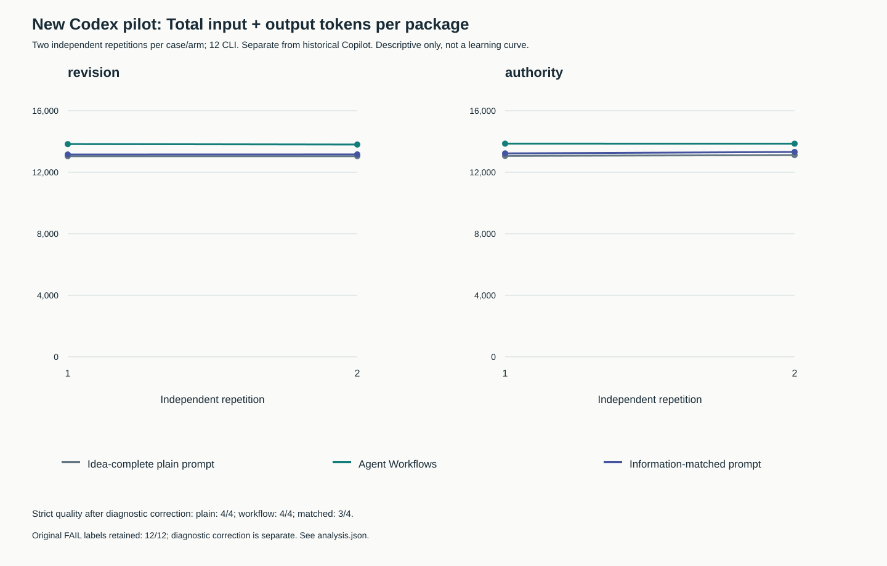
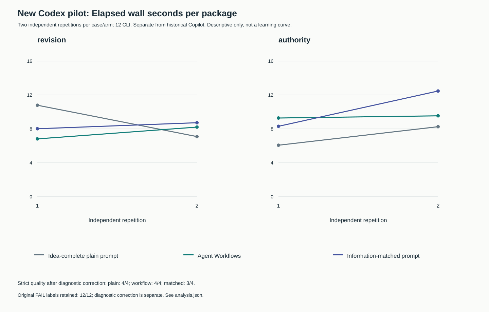
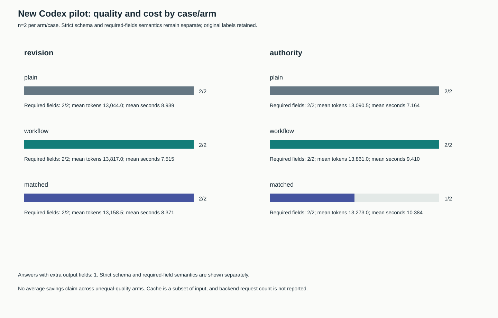
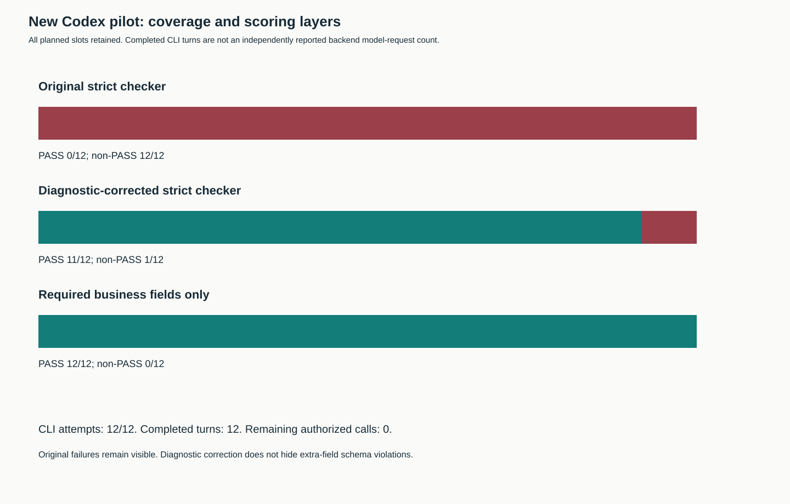

# Codex office pilot: actual runs after the provider switch

The user explicitly switched this experiment from Copilot CLI to **Codex CLI**
reporting that Copilot quota was exhausted. The pending Copilot device login was
cancelled. All Copilot markers, failed startup records and historical packages
remain unchanged. This is a separate provider campaign, not a resumed Copilot
trial or a pooled cross-provider average.

The Codex campaign completed **12/12 CLI invocations and 12 completed turns**,
with valid usage and unchanged workspaces. No auth, quota or accounting failure
occurred. The authorized 12-call cap is exhausted; no model retry was made after
the checker repair described below.

## Outcomes and cost

The original checker recorded 12 FAIL labels because it treated a CLI feature
warning as a tool call. Those labels remain immutable in
[observations.json](../../evidence/codex-office-20261103/observations.json).
After a separate diagnostic correction, strict artifact acceptance is **11/12**:
plain **4/4**, Agent Workflows **4/4**, information-matched **3/4**. Required
business fields are correct in **12/12**. These are distinct scoring layers.

The remaining strict failure is the second matched authority answer: it adds
`next_permitted_action`, outside the expected client schema. All required fields
including totals, unresolved authority conflict and approval/sending flags are
correct. The contract requests the listed fields and only the requested JSON,
but does not literally say "additionalProperties=false"; therefore an extra-field
failure must not be described as an incorrect readiness calculation. The strict
oracle and its original expectation were not relaxed to make it pass.

| Case | Arm | Strict after diagnostic repair | Mean total tokens | Mean wall seconds |
|---|---|---:|---:|---:|
| Revision/handoff | Idea-complete plain | 2/2 | 13044.0 | 8.939 |
| Revision/handoff | Agent Workflows | 2/2 | 13817.0 | 7.515 |
| Revision/handoff | Information-matched | 2/2 | 13158.5 | 8.371 |
| Authority conflict | Idea-complete plain | 2/2 | 13090.5 | 7.164 |
| Authority conflict | Agent Workflows | 2/2 | 13861.0 | 9.410 |
| Authority conflict | Information-matched | 1/2 | 13273.0 | 10.384 |

For equal-quality workflow/plain comparisons:

- Revision: workflow uses **5.93% more tokens**, with **15.93% less elapsed time**.
- Authority conflict: workflow uses **5.89% more tokens**, with **31.35% more time**.
- Pooled ratio of means across both cases (four packages per arm): workflow uses
  **5.91% more tokens and 5.10% more time**. This is a cost increase in this pilot,
  not an average reduction or a general statement about workflows.

Revision also has equal strict quality versus the matched prompt: workflow uses
5.00% more tokens and 10.23% less time. Authority workflow/matched efficiency is
not treated as an equal-quality comparison. Its measured costs remain visible.
Every percentage is reproduced in the
[analysis](../../evidence/codex-office-20261103/figures/analysis.json), using ratio
of means rather than a mean of paired percentage changes. Two repeats per cell
cannot establish statistical superiority or stable future latency.

## Frozen protocol and isolation evidence

The fixtures, seed, ordering, output contracts and hidden oracle were inherited
unchanged from the frozen office pilot: two cases × three arms × two repetitions.
All arms receive the same facts, output contract, permissions and tool ban.
Plain receives no candidate skill name/file/text; workflow appends `loop-work`;
matched adds general process organization without expected answers or hidden
test recipes. All are single-shot ephemeral sessions, one CLI per package.
This is direct instruction evaluation, not native skill discovery, workflow setup
or a graph/map test. No setup design cost is included.

The measured CLI was **0.166.0-alpha.5.1**; requested model **gpt-6.1-sol**,
reasoning **low**, timeout 150 seconds. The CLI events do not independently report
the actual resolved model or backend request count: these remain NOT_REPORTED
and null, respectively. A completed turn is not relabelled an internal model
request. Usage is the CLI's aggregate input/output/cache counters. Total tokens
are input + output; cached input and reasoning are not added again. No price or
invoice conversion is attempted.

Codex retained its configured authentication using `--ignore-user-config`, without
copying credentials or modifying global settings. Per-invocation settings disable
host skill discovery, bundled skill instructions, plugins/apps and shell/exec
tools, and set project instruction bytes to zero. An offline `debug prompt-input`
preflight showed no candidate names/catalog or ancestor instructions. Generic
Codex skill-use boilerplate remains. The first broad probe falsely matched a
mention of "Available skills" in that boilerplate; the more specific candidate/
catalog checks passed before model execution. No model calls were consumed by
preflight. See the [protocol](../../evidence/codex-office-20261103/protocol.json)
and [seal](../../evidence/codex-office-20261103/seal.json).

This is model-visible preflight evidence, not a full OS read trace or an
attestation of server-side context. The actual exec also ignores user config;
the debug interface has no equivalent flag and was checked with the explicit
overrides. Read-only sandboxes, no observed tool execution and unchanged empty
workspaces constrain effects; they do not prove absence of all external effects.
Prompt caching and service contention/latency remain uncontrolled. No skill-free
host isolation or causal efficiency claim goes beyond these measured checks.

## Checker repair without erasing failures

Each actual stream contains an `item.error` warning for the under-development
`skip_host_skill_discovery` feature, followed by the final assistant JSON. No
tool item occurred. The inherited checker allowed only reasoning/agent-message
items, so its `no_tools` check falsely failed every package. Original results,
usage, outputs and raw hashes are retained. The measured controller's exact
bytes are archived and match its frozen SHA-256; canonical source is repaired
after execution, so rerunning the old pin against changed source is STALE.

The repaired classifier accepts only that exact known CLI feature-warning
pattern as a passive diagnostic. It still rejects tool starts/completions and
unknown errors; unexpected CLI errors stop future runs. Negative controls cover
quota/unknown errors, tool attempts, missing/duplicate records, wrong values,
extra fields, policy violations and uncertain reservations. Original labels
are not overwritten. Strict regrade and required-field semantics are generated
offline from sanitized candidate JSON and item classifications.

One initial Codex launch was rejected by automatic approval review before
execution because it assumed the skill was private and previous destination
approval named Copilot. We then verified the skill text and fixtures against
their already-public GitHub bytes. A retry of the same bounded action was
approved on that evidence plus the user's explicit provider switch. Neither
review event consumed a model invocation. The
[publication proof](../../evidence/codex-office-20261103/publication-proof.json)
retains the public source commit, paths and hashes. No secret/private fixture
was transmitted, and no rejected action was launched indirectly.

## Reproduction and scope

The [packet README](../../evidence/codex-office-20261103/README.md) gives offline
analysis/render commands. Data, source pins, measured-controller archive, tables
and four SVG/PNG figures accompany the checker change in the same publication.
All PNGs were rendered and visually inspected. Private prompts, raw event logs,
home paths, auth material and the source PDF remain unpublished.

The [official configuration reference](https://learn.chatgpt.com/docs/config-file/config-reference)
supports the documented project/skill configuration keys; local CLI help and
feature inventory establish this exact installed version's flags. The
under-development feature warning is explicitly retained as a limitation.

No product skill, illustration, setup responsibility or release version changed.
The historical Copilot measurements and their requested six-arm line charts
remain separate. New local publication checks and remote CI must be assessed
at their own pins; earlier CI does not certify this campaign.

Publication checks: **14/14 local gates PASS**, 417 tests (415 PASS and two
platform skips), unchanged input fingerprint. See the [gate summary](../sessions/codex-office-20261103.json).
The final controller also rejects a schedule larger than 12 before invocation;
a mocked negative control failed before this guard and passed after it. All
actual measured calls used the original 12-slot schedule. The earlier local
gate passed before this final repair and is STALE for the current source; its
raw receipt remains retained. No extra model call was used to verify repairs.
Remote CI/CodeQL is checked after pushing this complete source/evidence commit.
