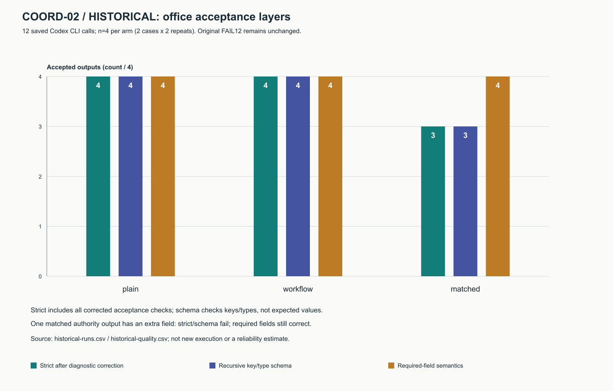
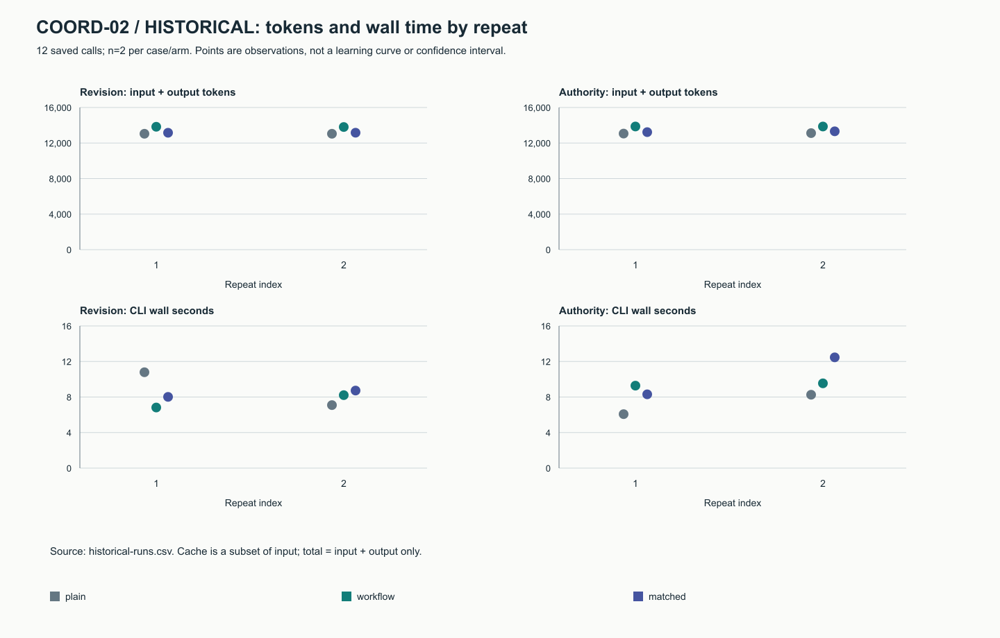

# Independent workflow coordination — COORD-02

Workflow Setup controls WHAT/NEXT/STOP: work order, conditional skill choices,
result routes, mandatory checks and bounded stopping. Agent Attention may adjust
HOW inside an explicitly selected scope. Neither needs the peer repository.
Optional integration is contract-v1 data exchange, not an implicit runtime import.
The five-axis helper contract is not proof that a model obeys five axes.

## Product checks and repairs

| Case | Observation before repair | Current verified behavior |
|---|---|---|
| Selected view | Editing returned skills/checks/sources mutated the graph | Independent copy preserves workflow intent |
| Versioned attachment | Legacy patch supported without explicit version | Legacy retained; integer1 opt-in, unknown fields/versions and intent edits diagnosed |
| Scoped processing | No complete scoped caller-profile facility | Graph/binding override restores exact caller profile on normal, exception, nested and early exit |
| No opt-in | Independent caller profile must remain independent | No mutation/restoration when no override exists; balanced selection metadata retained |
| Local experiment failure | Shared unscoped stops could affect unrelated work | Local markers by default; parse/process/output/schema/fixture/auth-home faults stay local |
| Provider quota/auth failure | Domain scope could not be represented | Same provider and verified domain only; unknown domain pauses that provider; other providers unaffected |
| Reservation race | Windows exclusive-lock transition raised PermissionError | Explicit blocked diagnostic; no lock bypass, stale deletion, retry refund or cap reset |
| Incomplete scoring data | Legacy scoring could PASS empty checks/items | Separate v2 rejects missing typed telemetry and assistant/check evidence |

The [contract reference](../../reference/coordination-contract.md) specifies
precedence, ownership, marker fields and compatibility. Literal integers are
required for versions/levels; booleans are rejected. Attention cannot add a step,
change authority, route or selected skill, or remove a mandatory check.
Deterministic tests cover standalone copied helper execution, immutable intent,
scope restoration, portable source paths, unknown conditions, stale markers,
provider/domain decisions and thread/process reservation races. The new ledger
is independently tested; older harness reservation formats remain compatible.
Their scoped marker decisions are wired into the harnesses. No old campaign or
marker was migrated or cleared. Switching identity/provider to evade a stop is
never authorized by the contract.

## Historical audit — zero new COORD-02 model calls

The read-only audit reconciled12 already completed Codex office traces against
frozen prompts, final messages, counters and measured source hashes. Original
FAIL12 remains unchanged. A separate diagnostic-corrected strict score is11/12;
required-fields semantics12/12. The extra-field schema failure is retained.
The frozen controller archive represents what ran; current source differs after
repairs. Integer process return codes were not separately persisted, so the audit
relies on retained `checks.exit_zero` for that field, not independent reconstruction.

Historical observations only, n4/arm (two cases × two repetitions). Structural
schema is a newly derived recursive key/type layer, separate from value checks;
original FAIL12 is unchanged. [SVG](../../evidence/coordination-function-charts-20261103/historical-quality.svg),
[source CSV](../../evidence/coordination-function-charts-20261103/historical-quality.csv),
[per-run rows](../../evidence/coordination-function-charts-20261103/historical-runs.csv).

Points show each saved observation, n2/case/arm; no interpolation, fitted trend or
reliability estimate. Total tokens include cached input once, not twice.
[SVG](../../evidence/coordination-function-charts-20261103/historical-cost.svg),
[source CSV](../../evidence/coordination-function-charts-20261103/historical-runs.csv),
[reproducible JSON and hashes](../../evidence/coordination-function-charts-20261103/README.md).

The original equal-quality pooled ratio of means remains **+5.91% input+output
tokens and +5.10% wall time** for workflow versus plain, with two repeats/case/arm.
This is instruction overhead in two small office cases, not a general savings or
coordination-effectiveness claim. `loop-work` already excludes turning a small
request into a process; focused/direct task paths remain appropriate.
Idea-complete prompts express all requested task ideas; oracle-rich prompts
add expected checks/answers/exceptions. They are not interchangeable baselines.

## Evidence and reproducibility

- [Public packet](../../evidence/coordination-function-20261103/README.md): audit,
  versioned regrade, common-v1 fixtures, failed controls and measured snapshots.
- [Original office campaign](2026-11-03-codex-office.md): immutable original
  labels, original source/data pins and descriptive figures; not a new run.
- [FUNCTION-03](2026-11-03-functional-workflow.md): subsequent product and model
  checks, kept separate from the historical audit.
- [Final local delivery receipt](../sessions/coordination-function-local-20261103.json):
  final source gate counts and verification scope, replacing stale earlier pins.

Run `python scripts/coordination_evidence.py` and
`python scripts/evidence_indexes.py` to reproduce published consistency checks.
Original private traces and machine-specific failure logs are not publicly
available for replay. Their retained hashes identify bytes; they do not authenticate
execution. No live combined-product, native picker or general token advantage was
established. No globally installed skill was updated.

## Initial source delivery verification

Source/evidence commit [`cf3cff1`](https://github.com/Clas4444/agent-workflows/commit/cf3cff1070d60efc31f6ee8068da5b8fa98b76f2) passed the exact-SHA Windows/Linux Python3.11/3.12 matrix and CodeQL Python/JavaScript/Actions. All61 changed public file bytes match GitHub downloads. [Remote receipt](../sessions/coordination-function-remote-20261103.json) separates this source SHA from its documentation-only follow-up. No additional model call or broader effectiveness claim follows from CI.

## Figure reproduction and checks

The inline PNGs have [SVG downloads, source CSV/JSON and byte hashes](../../evidence/coordination-function-charts-20261103/README.md).
Use `python scripts/coordination_charts.py` to regenerate and compare tables/SVG
without a model or a human-report dependency. PNGs were rendered and visually
reviewed; a focused test checks all four signatures/dimensions and inline report
embeds. Missing values remain null; a negative control rejects zero-filled usage.
The [chart follow-up local receipt](../sessions/coordination-charts-local-20261103.json)
records the final source checks separately from earlier delivery receipts. No
version bump, model call or edit to the original observations is involved.

Chart source [`485df41`](https://github.com/Clas4444/agent-workflows/commit/485df41fbe8e2b1664d2b0e31e9ae913ebbf2ecb) passed its exact-SHA Windows/Linux Python3.11/3.12 matrix and CodeQL Python/JavaScript/Actions. Final local checks:14/14 gates,464 tests (462 PASS,2 skips). All80 published file bytes and all four relative PNG targets match GitHub. [Chart remote receipt](../sessions/coordination-charts-remote-20261103.json) records this separately from earlier source deliveries and the documentation-only receipt follow-up.
