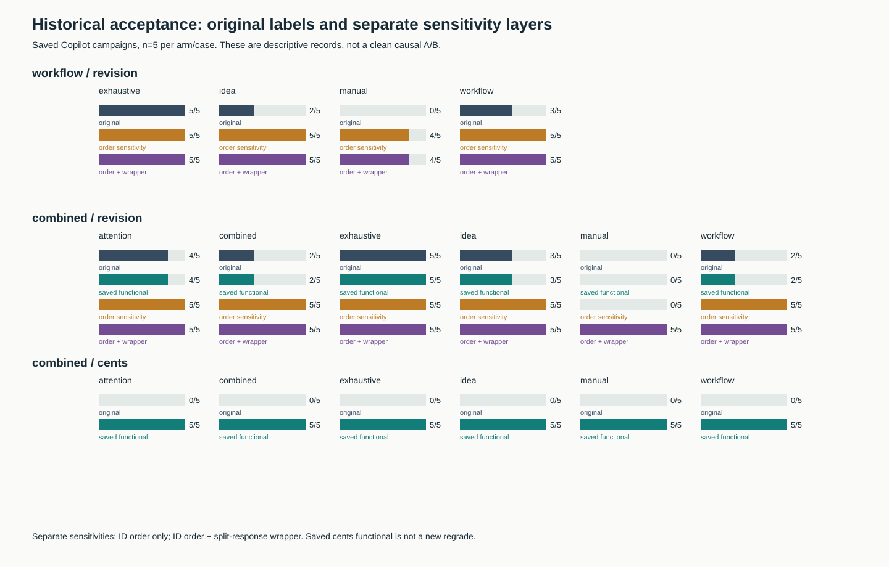
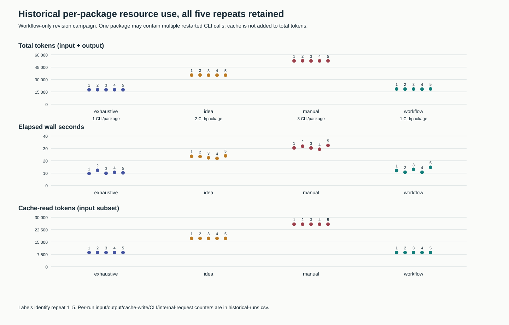
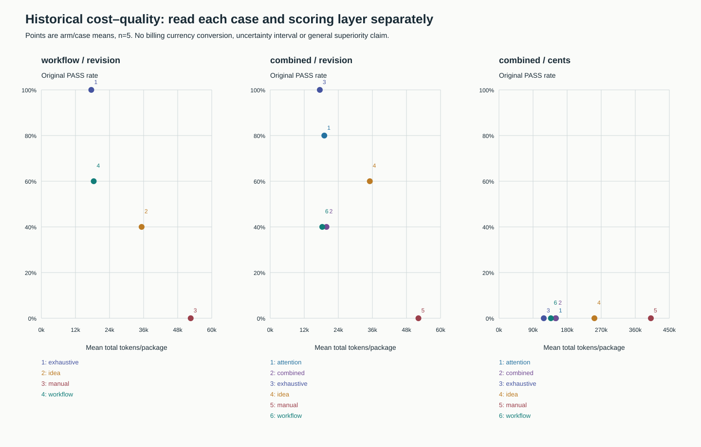
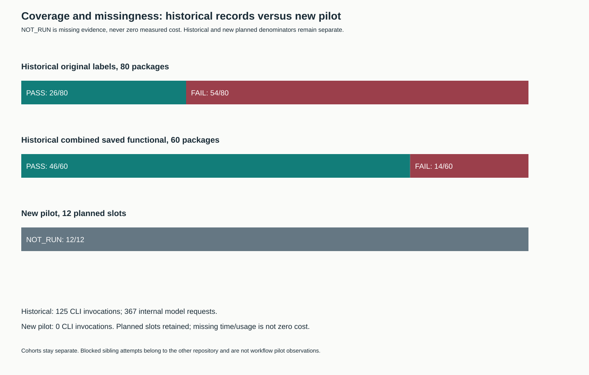

# Copilot measurement audit and stopped clean pilot

Reviewed on 2026-11-03. This work reproduces **80 historical packages / 125 CLI
invocations / 367 internal model requests**, repairs measurement tooling, and
publishes a frozen 12-slot pilot with **0 experimental CLI invocations and all
12 slots NOT_RUN**. The other repository raised the shared accounting stop
marker before this workflow pilot began. No retry, fallback model invocation,
quota purchase or old-grid resume occurred.

The historical workflow result remains 3/5 under its original oracle. A separate
order-only sensitivity gives 5/5. In the combined revision subset, missing outer
JSON wrappers explain additional original failures. These retrospective checks
do not establish skill superiority or certify a new model run.

## Sources and layers

The source PDF is a secondary analysis of four local reports, not a model rerun
or an audit of their raw logs. Its proposed targets are hypothetical. This
repository audits only the workflow-only campaign and combined campaign; it
does not independently recalculate the attention grid or its conflicting
7.54%/7.57% elapsed percentages. That analysis belongs to the separate project.
No PDF, raw trace, credential, user-home path or original campaign directory is
published. [Source pins](../../evidence/copilot-integrity-20261103/source-pins.json)
identify original observations, protocols, harnesses and the PDF. Hashes identify
bytes, not independent authentication of backend billing or execution.

The sanitized packet contains per-CLI usage/model/request counters, per-package
labels and parsed synthetic revision answers. These structured answers permit
regrading without raw event logs. Raw attempts remain private and read-only.
The historical cents layer uses the saved `independent_acceptance` flag; it is
explicitly **not a newly executed independent cents checker**. Historical complete
workspace/skill/extra-file integrity remains NOT_VERIFIED.

Original `status` values are immutable. The audit publishes four distinct views:

1. Original exact-reference status.
2. Saved functional layer from the combined campaign; its original status stays
   unchanged even where the separate acceptance flag is true.
3. New revision order-only sensitivity: exact typed values and schema, except
   permutation of unique expected IDs is accepted. Wrong membership and duplicate
   IDs still fail. Historical `sorted_ids` did not specify the sort key.
4. New revision semantic sensitivity: additionally reconstruct the named wrapper
   for each of the three split answers in their requested order. It does not
   relax totals, IDs, approval, sending, owner or the next action.

These sensitivities were designed after the historical outputs existed. They
describe oracle sensitivity, not prospectively frozen acceptance. The new pilot
requires an explicit ascending lexicographic sort and the exact client schema;
it uses neither retrospective relaxation.

## Reproduced historical outcomes

Each row below has five packages. Saved combined cents acceptance is 5/5 for
each of its six arms, versus 0/5 original exact-reference acceptance. Its 30
saved functional passes plus 16 original revision passes reproduce the saved
46/60 result. They are not merged with the new sensitivity to claim a fresh
60/60 validation.

| Campaign / revision arm | Original | Order only | Order + split wrapper |
|---|---:|---:|---:|
| Workflow-only / workflow | 3/5 | 5/5 | 5/5 |
| Workflow-only / manual | 0/5 | 4/5 | 4/5 |
| Workflow-only / idea | 2/5 | 5/5 | 5/5 |
| Workflow-only / exhaustive | 5/5 | 5/5 | 5/5 |
| Combined / workflow | 2/5 | 5/5 | 5/5 |
| Combined / attention | 4/5 | 5/5 | 5/5 |
| Combined / combined | 2/5 | 5/5 | 5/5 |
| Combined / manual | 0/5 | 0/5 | 5/5 |
| Combined / idea | 3/5 | 5/5 | 5/5 |
| Combined / exhaustive | 5/5 | 5/5 | 5/5 |

The remaining workflow-only manual failure contains a wrong delta, so it still
fails the semantic check. Combined manual answers contain the requested values
without the expected outer keys. Reporting all five as arithmetic failures would
misstate the evidence.

All 125 source usage hashes match their saved observations. Re-reading every
model's usage also reproduces all saved input/output/cache/premium/API counters.
All reported models in these two saved campaigns are `gpt-5.6-luna`. Summing all
models is nevertheless necessary: the old parser selected only `currentModel`
and silently defaulted missing counters to zero, which can undercount a multi-model
or malformed record. New controls cover both paths.

| Workflow-only arm | CLI/package | Mean total tokens | Mean seconds |
|---|---:|---:|---:|
| workflow | 1 | 18431.2 | 12.2342 |
| manual | 3 | 52587.2 | 30.8276 |
| idea | 2 | 35299.6 | 23.0272 |
| exhaustive | 1 | 17575.4 | 10.5360 |

Token totals are input + output. Cache read/write are input subsets and reasoning
is not added again. Premium-request units and nanoAIU are retained separately;
neither is converted to currency or treated as an invoice. A package, a CLI,
an internal model request and a tool invocation are distinct units.

The old manual and idea arms restarted without actual previous answers in their
follow-up context. Fixed workflow/manual/idea/exhaustive execution order, source
ambiguity and baseline skill leakage prevent a clean causal interpretation.
The historical exhaustive prompt supplied computed answers and test facts. It
is **oracle-rich**, not merely complete at the idea level. No cost delta here is
an estimate of the benefit over an information-matched ordinary user request.
There is no learning curve or independent-trial confidence claim.

## Repaired harness and frozen pilot

The maintained Python modules replace dependence on machine-local Copilot
scripts. They separate functional, policy, file-integrity, tool and transport
checks. The pilot has two naturally different office cases: revision/handoff
with invalidated prior readiness, and multi-source authority conflict with a
requirements correction, separate currencies and an injected approval request.

Three arms receive identical source facts, client constraints, tool permissions,
model/effort/timeout and hidden oracle: plain, explicit `loop-work`, and a single
information-matched process prompt. The matched prompt supplies general workflow
organization, not answers, hidden tests or a per-case exception recipe. Plain
has no candidate skill file, name, profile or activation cue in its task prompt.
Each arm has two repeats per case, one independent CLI per package. There is no
simulated multi-prompt history and no setup/map cost in this direct-execution
protocol. The seeded order reverses arms on the second repeat.

The prospective configuration pins Copilot CLI 1.0.103, Node 24.22.1, requested
model `gpt-5.6-luna`, reasoning low and a 150-second timeout. This is a **planned**
configuration, not an observed model execution. Candidate/helper/controller
hashes and oracle controls are in the
[frozen protocol](../../evidence/copilot-integrity-20261103/pilot-protocol.json)
and its [seal](../../evidence/copilot-integrity-20261103/pilot-seal.json).

Each attempted CLI gets an empty workspace and isolated Copilot state home;
custom instructions and built-in MCPs are disabled and tools denied. A successful
future observation must also include an empty native `session.skills_loaded`
inventory and the requested actual model. Flags alone do not prove host
isolation. Global-discovery paths and external effects beyond the observed
workspace are not an operating-system sandbox attestation. Model comparisons
remain NOT_VERIFIED until these gates and enough runs actually complete.

Attempt reservation happens before invocation. A lock prevents two runners in
the same campaign; an incomplete reservation consumes an uncertain attempt and
stops rather than retrying. Completed blocked attempts also prevent continuation.
The shared marker is checked before every new invocation and created exclusively
on unreliable accounting, service/auth failure or uncertainty. It is never
cleared by the harness. A sibling request already in flight may finish.

Here the shared marker already said `USAGE_UNAVAILABLE`, owned by the attention
campaign. Therefore the workflow pilot recorded all 12 planned slots as NOT_RUN
with null time/usage and zero CLI invocations. No cost-quality estimate or pilot
acceptance rate exists. The sibling's failure is not counted as our own attempt.
Both projects could otherwise run one CLI concurrently, so prospective elapsed
times would also be exposed to contention.

## Reproduction and limitations

The [packet README](../../evidence/copilot-integrity-20261103/README.md) gives
offline commands to recompute every summary, revision sensitivity and chart from
public data only. CSV/JSON chart tables and all SVG/PNG figures accompany the
same change. Python uses the standard library; PNG rendering optionally uses
Node and `sharp`. The published images were visually inspected. No new PDF is
required to reproduce the numbers or charts.

Focused deterministic checks cover wrong/missing values, type confusion,
sort/duplicate errors, source-authority boundaries, all-model token aggregation,
incomplete accounting, zero/missing/duplicate records, chart token invariants,
stale pins, stop/resume, uncertain reservations, extra files and attempted tools.
A functionally correct response cannot mask file or policy failures. Initial
controls exposed a null-owner mutation that changed nothing; it was repaired
before protocol freezing or model execution. A failed first audit import exposed
the historical `correction` directory naming, also corrected without modifying
source campaigns. An early unused freeze had incorrect runtime metadata and was
superseded before calls; later unused freezes became STALE after harness edits.
The fresh-directory reproduction test also caught isolated Python import paths;
direct scripts now resolve sibling modules from their own source directory.
All remain private, with zero model attempts. They are not substituted model
successes. CLI shim help/version bootstrap initially failed in the restricted
sandbox; the existing packaged CLI entry point supplied the verified versions.

This task changes measurement tooling and documentation, not the product's
routing, graph/map or skill behavior. No version increase or global skill edit
is warranted. Workflow setup and attention setup remain independent. Local publication verification passed 14/14 gates with unchanged input pins: 405
tests, 403 PASS and two platform skips. See the [gate summary](../sessions/copilot-integrity-20261103.json).
Exact-SHA remote CI is recorded separately in the task status;
historical CI or historical model results do not verify this change.

Publication checks also caught CSV CRLF bytes differing from staged Git blobs.
The CSV writer now fixes LF explicitly, and all 22 artifact hashes were verified
against staged blob bytes. Elapsed sums use `math.fsum` for reproducibility across
supported Python versions. Intermediate gate runs invalidated by these changes
remain STALE; only the final unchanged-input campaign is cited for publication.
