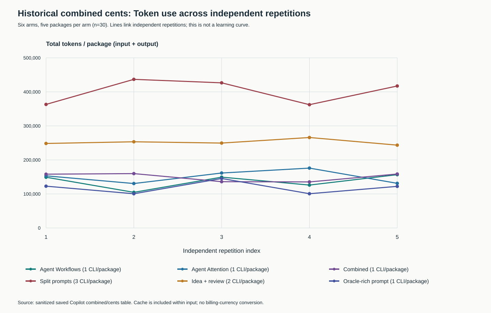
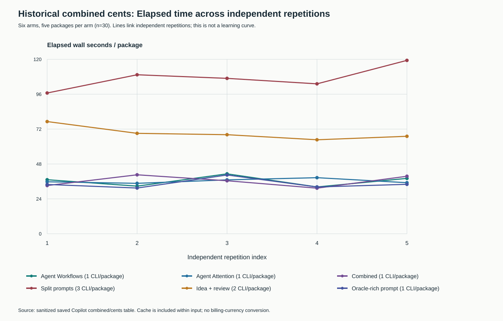

# Requested line charts and recovery status

This follow-up adds the two requested line charts from the historical combined
cents experiment: total tokens per package and elapsed wall seconds per package,
with all six arms across five repetitions. There are 30 historical packages;
manual packages contain three CLI invocations and idea/review packages two.
No new model measurement is blended into these lines.

The numeric ticks, units, palette, legend and light grid make the independent
repetitions comparable to the requested PDF figure types. Lines connect separate
restarted packages for readability; they are not a learning curve or evidence
of improvement over time. Tokens are input + output; cache is already included
within input. The historical exhaustive arm is labelled **Oracle-rich prompt**
because it received expected answers; it is not an information-matched baseline.

The [source CSV](../../evidence/copilot-integrity-20261103/figures/historical-runs.csv)
is unchanged. The [new table](../../evidence/copilot-recovery-20261103/figures/line-data.csv)
and [JSON with source hash](../../evidence/copilot-recovery-20261103/figures/line-data.json)
contain every plotted point. The [packet README](../../evidence/copilot-recovery-20261103/README.md)
gives reproducible generator/render commands. Both PNGs were rendered and viewed.
Focused controls reject missing/duplicate repetitions, wrong token totals, cache
double counting and unexpected package CLI counts.

## Recovery is separate from the historical data

The recovery decision attributes the original attention startup failure to
`HARNESS_RELATIVE_CWD`, rather than a proven quota limit. Its absolute-path
`--version` and `--help` preflight succeeded. The old marker and observations
remain retained; the old workflow pilot remains 12 NOT_RUN, zero invocations.
See the [sanitized decision](../../evidence/copilot-recovery-20261103/recovery-decision.json).
This corrects the interpretation of the earlier generic `USAGE_UNAVAILABLE`
marker without relabelling the recorded attempt or fabricating model results.

A new workflow instance was proposed using the unchanged frozen fixture/model/
seed protocol and a new recovery marker, capped at 12 experimental CLI attempts.
Automatic approval review rejected the launch **before execution** because it
requires direct human approval for sending the synthetic fixtures and `loop-work`
content to the configured GitHub Copilot model service. The attempted shell cell
did not execute, so this rejection consumed zero experimental CLI attempts.
A direct authorization question is pending; no indirect launch or workaround
was attempted.

While that approval was pending, the sibling campaign created the new shared
marker with reason `MALFORMED_USAGE`. This is an accounting stop observation,
not proof of quota exhaustion and not a workflow task FAIL. Workflow has made
zero recovery CLI invocations. Further model work requires the direct payload
approval and a valid recovery decision after the accounting issue is resolved;
this repository does not clear either marker or modify the peer repository.

The [launch-status record](../../evidence/copilot-recovery-20261103/launch-status.json)
keeps these separate blockers explicit. There is no new-model acceptance rate,
time saving or token saving to estimate yet. Neither successful CLI help nor
historical line charts establish that a clean model pilot has completed.

Local publication verification: 14 gates PASS, 407 tests (405 PASS and two platform
skips), with unchanged input pins. See the [gate summary](../sessions/copilot-lines-20261103.json).
The nine new artifact hashes match staged Git bytes; the original historical
packet remains byte-for-byte unchanged. Remote CI is verified separately after push.
